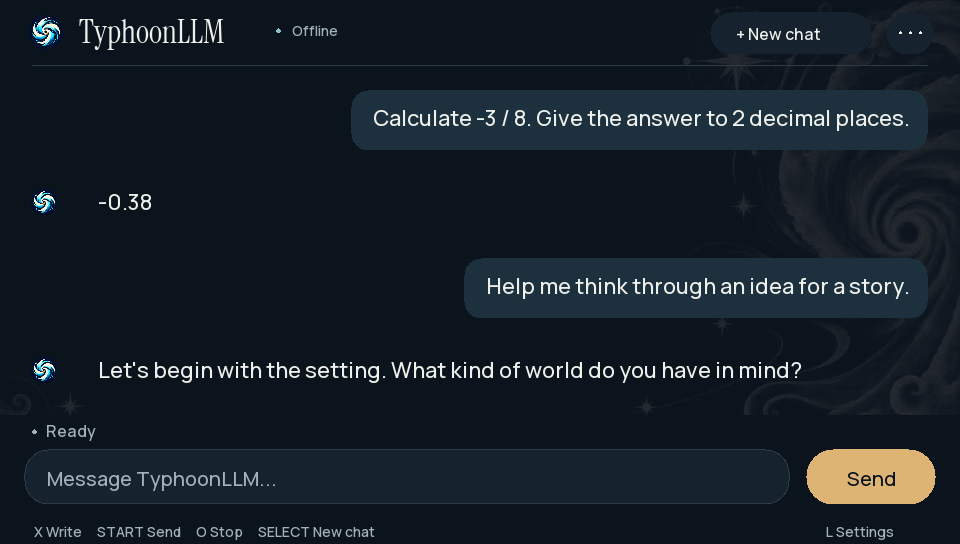
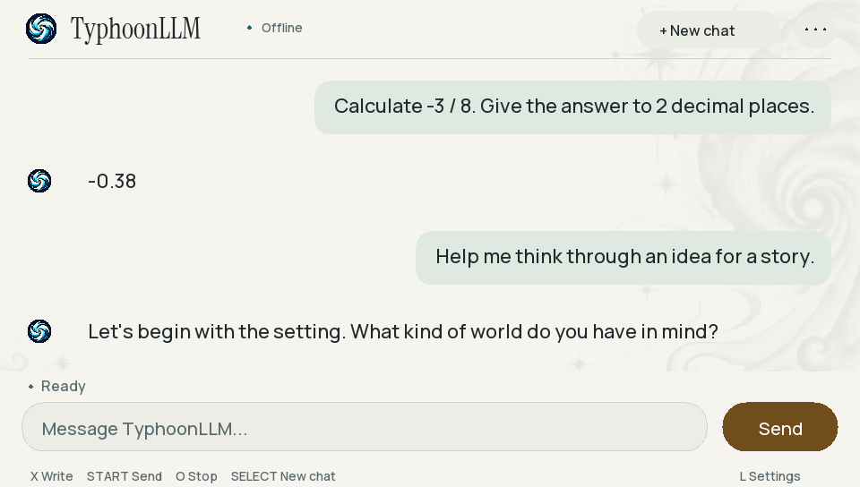

# TyphoonLLM

**Fully local LLM inference on PlayStation Vita.**

TyphoonLLM is an offline conversation application designed for homebrew-capable PS Vita hardware. It runs Liquid AI’s LFM2.5-230M through a native ARMv7 runtime, evolving from earlier VitaLM and WoozyLLM experimentation. **03.05 is the current stable installed release**, retaining documented model limitations.

## Features

- Offline inference with no cloud/API dependency.
- Merged procedural LoRA adaptation and Q8 group64 deployment.
- Default bounded multi-turn conversation, responsive Stop, state-clearing New chat and bounded automatic continuation.
- Separate deterministic arithmetic routing, including supported ties-to-even formatting.
- Native Vita keyboard, touch/button input, Typhoon branding, Dark default and Light toggle.
- A small dated offline reference database; reference/calculator output is separate from neural generation.

## Screenshots

Final installed application capture:

Preserved editorial renderer previews, not additional physical benchmark results:

## Installation

A homebrew-capable/jailbroken Vita and VitaShell are required. Download the final VPK **and model.vlp and tokenizer.bin** from this repository’s Releases. Transfer the model/tokenizer to `ux0:data/VitaLMChat/`, install the VPK through VitaShell, then launch TyphoonLLM from LiveArea. The VPK does not bundle weights. See [INSTALLATION.md](INSTALLATION.md).

## Model

The backbone is **LiquidAI/LFM2.5-230M**, with merged rank-4 procedural LoRA adaptation for arithmetic and constrained formatting. Q8 group64 stores weights in groups of 64 with scale metadata. Execution uses dynamic Q8 activations and FP32 norms/convolution kernels. All inference runs offline on the Vita. [Model and provenance](MODEL_AND_PROVENANCE.md).

## Performance

Preserved physical measurements of the selected model/runtime, three prompts × three repeats: model **244,215,040 bytes (232.90 MiB)**, TTFT **3.708–4.736 s**, prompt **3.80–4.31 tokens/s**, decode **1.66–1.91 pieces/s**. Load was 18.866 s; sampled live heap was 29.87 MiB excluding the model block, not peak RSS. These measurements predate 03.05 branding; no new final-release speed evaluation is claimed. Final runtime statistics specify fixed 12 MiB KV. See [BENCHMARKS.md](BENCHMARKS.md).

## Architecture

LFM combines short convolution and grouped-query attention blocks. The native C runtime uses ARMv7 NEON, a persistent main-plus-two-worker pool, quantized operations, byte-level BPE, attention KV and convolution state. The app adds arithmetic/reference routing and bounded sessions. [ARCHITECTURE.md](ARCHITECTURE.md).

## Known limitations

The small model can invent/omit facts and mishandle corrections or ambiguity. Long prompts are slow, context is bounded and font/Unicode coverage is limited. Theme is process-local; some statistics retain earlier/last-segment values. Quality evidence is provisional agent review, not independent human validation. [Full limitations](KNOWN_LIMITATIONS.md).

## Building, credits and notices

[BUILDING.md](BUILDING.md) documents the actual preserved CMake build and reproducibility limits. Source is in [src/](src/).

Credits: Liquid AI; WoozyLLM/llama2.c and GGML runtime lineage; VitaSDK; Manrope, Instrument Serif and retained Inter fonts; generated storm artwork; GeoNames and cited offline factual sources. See [THIRD_PARTY_NOTICES.md](THIRD_PARTY_NOTICES.md), [MODEL_AND_PROVENANCE.md](MODEL_AND_PROVENANCE.md), [LICENSE_NOTES.md](LICENSE_NOTES.md) and [CHANGELOG.md](CHANGELOG.md).

No top-level WoozyLLM license was preserved. This handoff does not invent a blanket source license or establish unrestricted redistribution rights.
